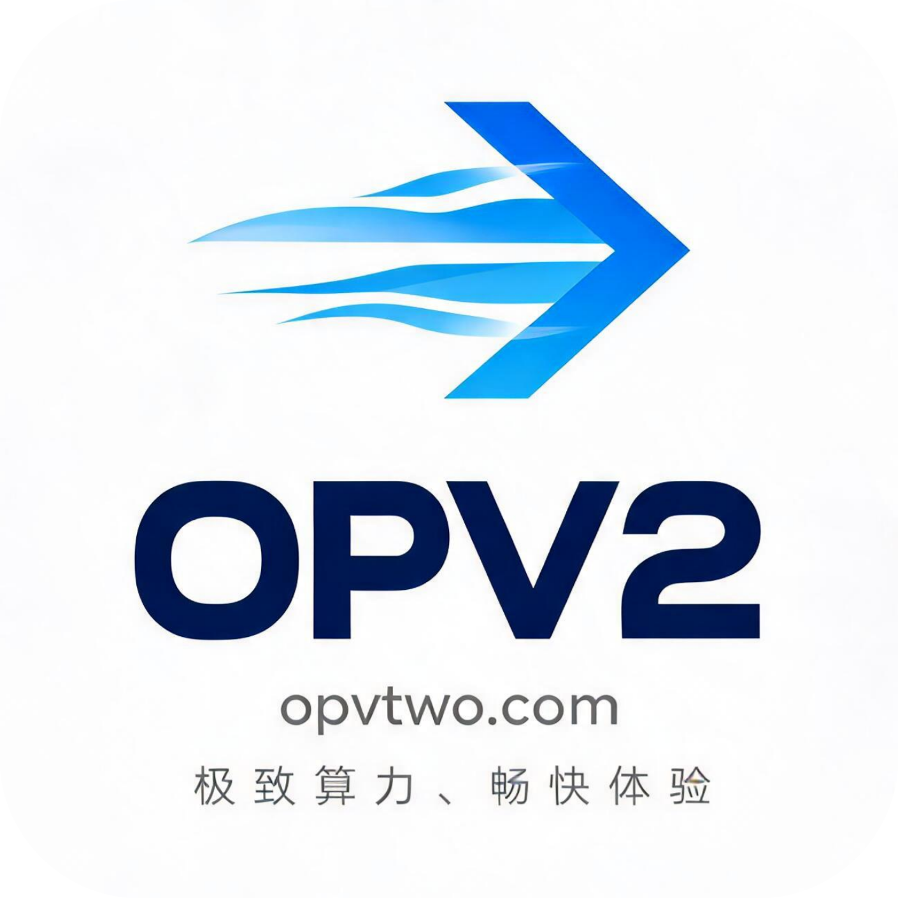
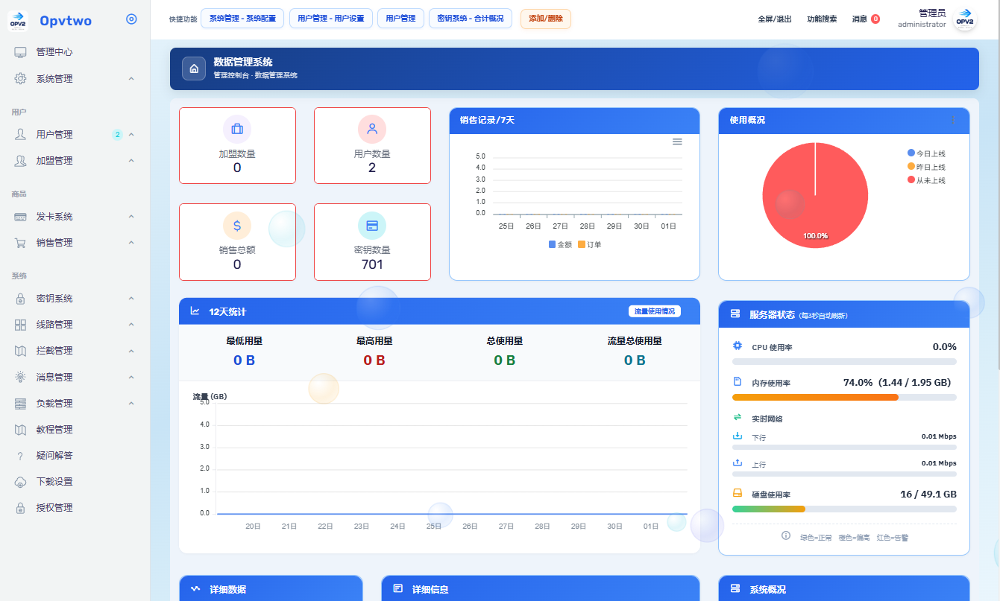
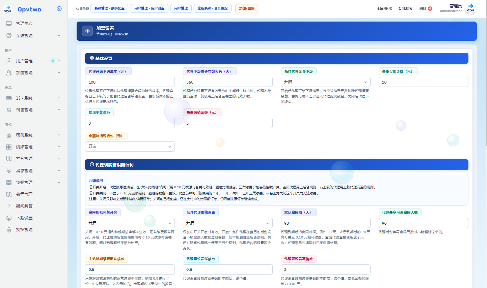
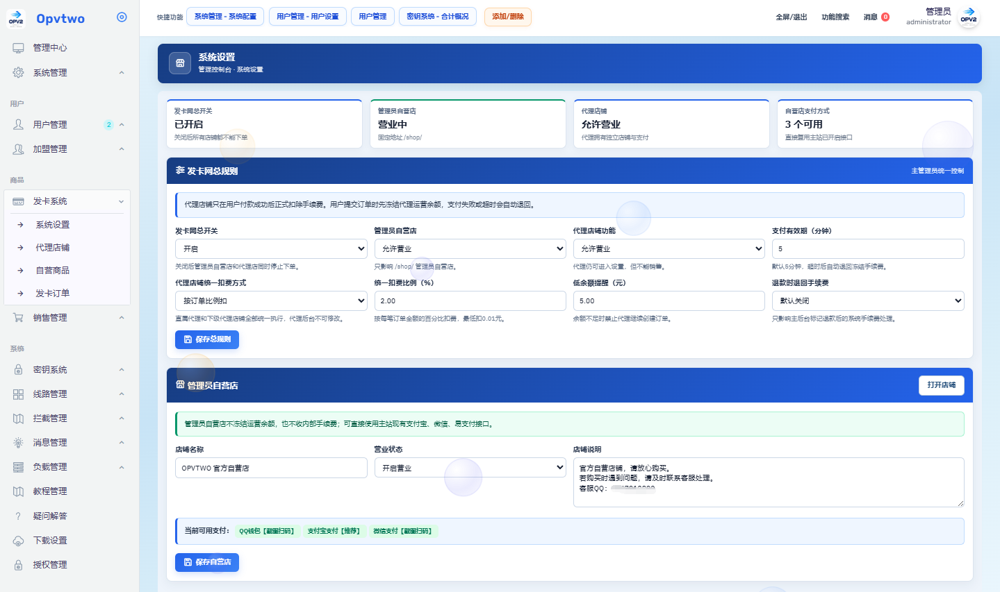
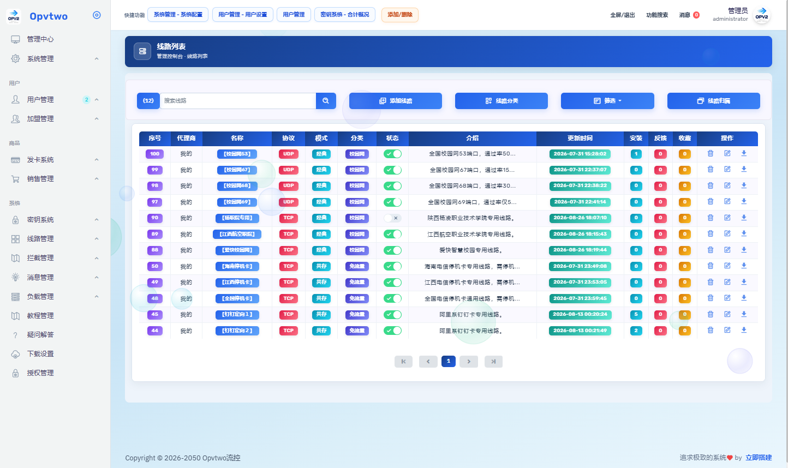

  
  <h1>OPVTWO 流控系统</h1>
  
免流系统、机场面板、云免平台、V2 节点订阅管理与校园网认证的一体化流控文档。

  

    <a href="https://home.opvtwo.com/"><strong>官方网站</strong></a>
    &nbsp;·&nbsp;
    <a href="https://jiuchengyige-web.github.io/opvtwo-docs/"><strong>在线展示页</strong></a>
    &nbsp;·&nbsp;
    <a href="./docs/quick-start.md"><strong>快速开始</strong></a>
  

> 本仓库仅用于 OPVTWO 流控系统产品介绍、界面展示和使用文档，**不包含核心程序、数据库、授权接口或服务器配置**。

## OPVTWO 流控系统是什么

OPVTWO 流控系统是面向流控运营场景的一体化管理系统，可用于免流系统、机场面板、云免平台、V2 节点订阅管理、校园网认证等运营场景。它将 OP 与 V2 节点、用户订阅、线路推送、五级代理分销、发卡商城、订单支付和授权验证放在同一套后台中，减少重复配置与数据割裂。

## 核心能力

| 模块 | 能力 |
| --- | --- |
| 双内核管理 | 集中接入 OP 与 V2 节点，查看在线人数、用户流量和节点状态 |
| 用户与订阅 | 套餐、流量、到期时间、冻结、副号、签到和订阅配置 |
| 线路管理 | 线路分类、排序、开发者推送与节点安装信息维护 |
| 代理分销 | 百分比分销和固定拿货成本两种模式，支持五级代理体系 |
| 发卡商城 | 自营与代理店铺、卡密、订单、在线支付和退款处理 |
| 运营安全 | 优惠活动、广告拦截、授权验证、过期踢线与安全检查 |

## 界面预览

| 管理仪表盘 | 代理分销 |
| --- | --- |
|  |  |

| 发卡商城 | 线路管理 |
| --- | --- |
|  |  |

## 适用场景

OPVTWO 流控系统适用于免流系统、云免平台、机场面板、V2 节点与订阅管理、校园网认证、校园网登录、线路推送、代理分销、发卡商城和流控运营管理等场景。

## 文档导航

- [快速开始](./docs/quick-start.md)
- [功能模块](./docs/modules.md)
- [环境要求](./docs/requirements.md)
- [安全说明](./docs/security.md)
- [常见问题](./docs/faq.md)

## 官方入口

- 官网与安装入口：[https://home.opvtwo.com/](https://home.opvtwo.com/)
- 免搭建成品服务：[https://fast.opvtwo.com/](https://fast.opvtwo.com/)
- 在线展示页：[https://jiuchengyige-web.github.io/opvtwo-docs/](https://jiuchengyige-web.github.io/opvtwo-docs/)

安装命令、授权购买、版本更新和售后联系方式，请统一以官网当前发布的内容为准。